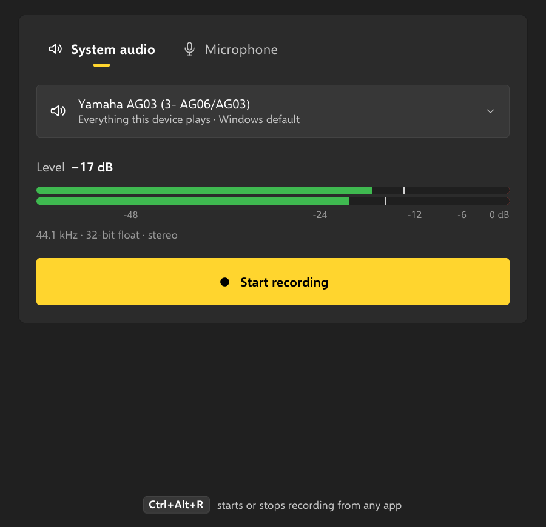
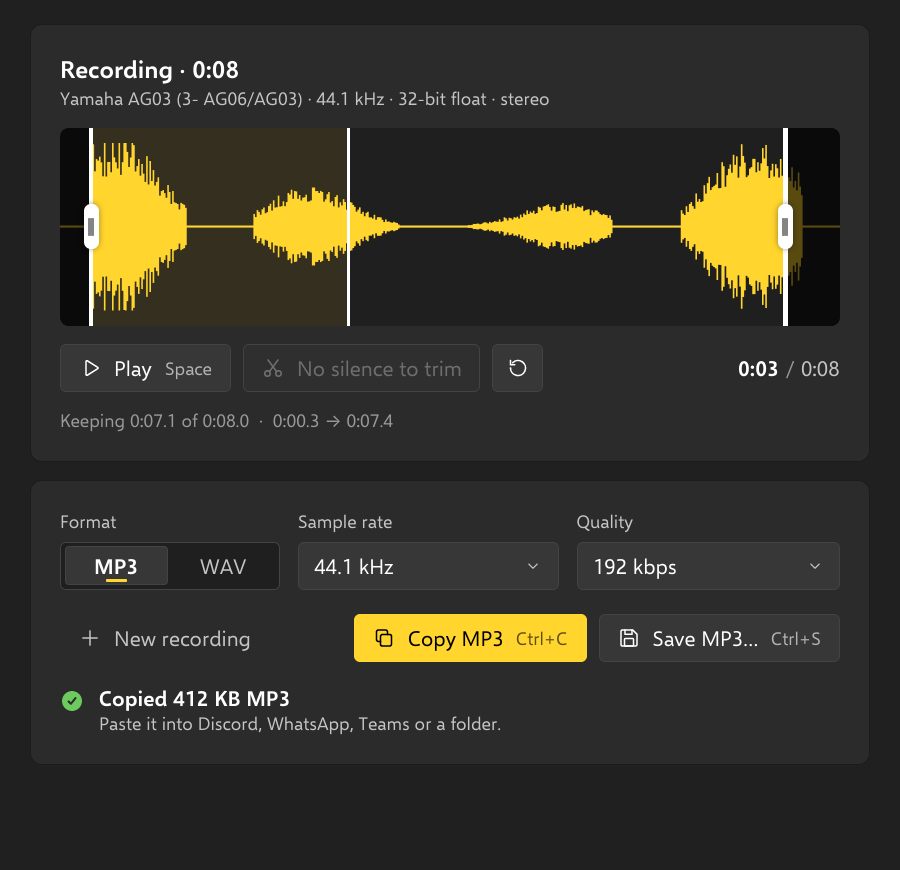

# RecordThis (Rust)

A Windows 11 audio recorder. It records a microphone, or **everything a speaker or headphone output plays** (WASAPI loopback), writing straight to disk as it goes. Then you trim the recording and copy it (to paste into Discord, WhatsApp, Teams…) or save it as MP3 or WAV.

This is a Rust + [Slint](https://slint.dev) port of the original C#/WinUI 3 app, with a reworked UI.

| Recording | Review |
|---|---|
|  |  |

> **Status:** the audio pipeline, file handling and app logic are covered by unit tests and an end-to-end self-test against simulated devices, and the Windows build compiles cleanly. **The Windows-specific layer (WASAPI, Media Foundation MP3, clipboard, hotkey, sleep handling, title bar, taskbar badge) has not yet been run on a real Windows PC.** See [Testing checklist](#testing-checklist).

## Requirements

- Windows 10 (1903+) or Windows 11, x64 or ARM64
- To build: [Rust](https://rustup.rs) (stable) with the MSVC toolchain, and Visual Studio Build Tools with the "Desktop development with C++" workload. Nothing else; there's no runtime to install.

## Build and run

```powershell
cargo run --release            # build and start
cargo build --release          # → target\release\RecordThis.exe (single file, no dependencies)
```

ARM64: `rustup target add aarch64-pc-windows-msvc`, then `cargo build --release --target aarch64-pc-windows-msvc`.

**GitHub Actions:** `.github/workflows/build.yml` runs the tests and builds x64 and ARM64 EXEs on every push. Download them from the run's **Artifacts**. The EXE is unsigned, so SmartScreen will warn on first launch (**More info → Run anyway**).

## Using it

1. Choose **System audio** or **Microphone**, then the device. The level meter is live for system audio; for microphones press **Test mic**.
2. **Start recording**, or press **Ctrl+Alt+R** from any app (the taskbar button shows a red dot while recording).
3. **Stop recording** (or Ctrl+Alt+R) opens the review screen.
4. Trim by dragging the handles, **Trim silence**, or **[** / **]** at the playhead. **Space** plays and pauses, **←/→** move the playhead, **Home/End** jump to the trim points.
5. Pick **MP3** or **WAV**, then **Copy** (Ctrl+C, puts the file on the clipboard) or **Save…** (Ctrl+S). The format applies to both.

Settings live in `%LOCALAPPDATA%\RecordThis\settings.json` (same file as the C# version). If the app crashes or loses power mid-recording, the next launch offers to recover the audio, including recordings left behind by the C# version.

## What changed from the C# version

**Performance and size.** One native EXE with no .NET or Windows App SDK runtime to load, so it should start almost instantly and use far less memory (not yet measured on Windows). The audio path is the same design (raw packets to disk, streamed export), now with no garbage collector involved.

**UI and UX:**
- The level meter is live before recording (system audio automatically, microphones on demand), with separate L/R bars, a dB scale, peak hold and a CLIP flag.
- The developer jargon ("WASAPI Loopback") and the off-screen shortcut cheat sheet are gone; shortcuts are shown on the buttons they trigger.
- While recording: red **Stop recording** button with the elapsed time, "● Recording 0:42" in the title, and a red dot on the taskbar button.
- Proper app icon (the C# build showed the generic EXE icon).
- Review: "Recording · 0:08" header, times that fit their length (0:08, 4:12, 1:02:33), grip-style trim handles that show their times while dragging, and "No silence to trim" instead of an unexplained disabled button.
- Export: an **MP3 | WAV** toggle that applies to Copy *and* Save (Copy used to be MP3 regardless). Discard is a quiet button set apart from Copy/Save, and becomes **New recording** once you've copied or saved.
- Results ("Copied 412 KB MP3", "Saved …  · Show in folder") appear right under the buttons.
- Compact window, follows Windows light/dark mode and your accent colour, and the title bar is coloured to blend in. (Slint can't draw Mica, so the background is a solid Mica-like colour.)

**Behaviour:**
- MP3 still uses Windows' built-in encoder, but it's loaded on demand, so the app also starts on Windows "N" editions. There, Copy falls back to WAV and Save MP3 explains how to get the encoder.
- After sleep/resume or a device change, the idle meter reconnects by itself.
- Closing with a recording you copied but didn't save no longer asks "Save before closing?".

## Code map

| Area | File |
|---|---|
| WASAPI capture/loopback + silence watchdog, spool writing, live meter | `src/audio/capture.rs`, `src/platform/windows/audio.rs` |
| Raw spool → float decoding | `src/audio/convert.rs`, `src/audio/reader.rs` |
| ITU-R BS.775 downmix + clip-safe gain | `src/audio/downmix.rs` |
| Exact-length sinc resampler (rubato) | `src/audio/resample.rs` |
| 16-bit TPDF dither / 24-bit WAV writer | `src/audio/wav.rs` |
| Export pipeline (WAV, MP3 via Media Foundation) | `src/audio/export.rs`, `src/platform/windows/mp3.rs` |
| Waveform + silence detection | `src/audio/waveform.rs` |
| Review playback | `src/audio/playback.rs` |
| Device list + hot-plug (IMMNotificationClient) | `src/platform/windows/devices.rs` |
| Hotkey, sleep, clipboard, shell, accent, title bar, taskbar | `src/platform/windows/shell.rs` |
| Spool files + crash recovery, settings | `src/storage/` |
| Error → user guidance | `src/errors.rs` |
| Screen logic (the old view models) | `src/app/` |
| UI | `ui/*.slint` |

On other operating systems the `platform` module swaps in simulated devices (`src/platform/demo.rs`), so the whole app can be developed and tested anywhere:

```sh
cargo test --lib                                         # DSP, spool, settings, export
cargo run --features screenshots --bin selftest          # end-to-end controller test, no display needed
cargo run --features screenshots --bin screenshots out   # renders every screen state to PNG
```

## Testing checklist

Things only a real Windows PC can confirm:

- [ ] System audio: meter moves while music plays; recording includes silent stretches at the right length
- [ ] Microphone: Test mic; recording; privacy block shows the "Open privacy settings" banner
- [ ] Unplug the device mid-recording → review screen with "device disconnected"
- [ ] Ctrl+Alt+R while minimized; red dot on the taskbar button
- [ ] Play / pause / seek / trim during playback
- [ ] Copy MP3 → paste into Discord or Explorer
- [ ] Save MP3 and WAV (16- and 24-bit; 44.1 and 48 kHz)
- [ ] Sleep while recording → recording finalized, banner on wake
- [ ] Kill the process mid-recording → recovery banner on next launch
- [ ] Light/dark mode switch; accent colour; 100% / 150% scaling

## Licence

RecordThis is Apache-2.0. Slint is used under its [royalty-free desktop licence](https://github.com/slint-ui/slint/blob/master/LICENSES/LicenseRef-Slint-Royalty-free-2.0.md) (which asks that the app credit Slint, e.g. on its website or in an About box) or GPLv3, at your choice.
